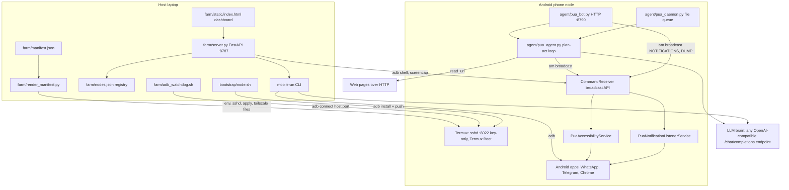
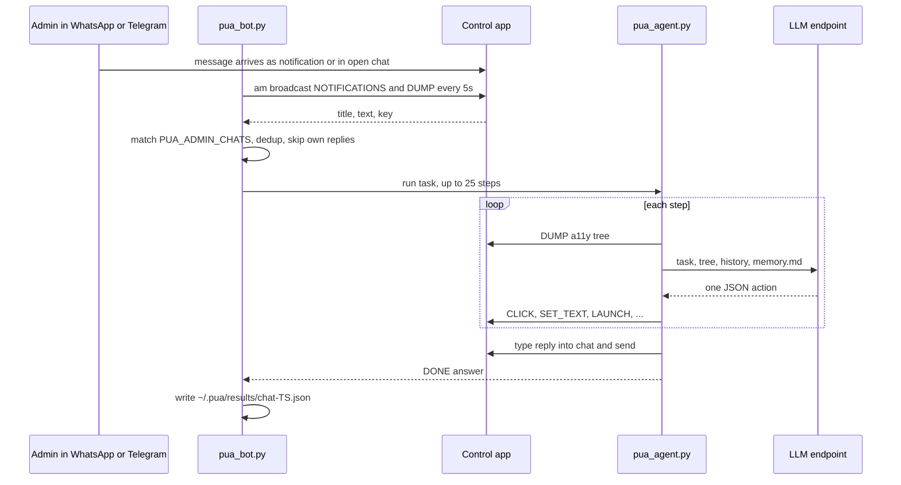

# phoneuse-agent

**Turn old Android phones into AI-operable agent nodes.**

PUA (phone-use agent) is to phones what CUA is to desktops. An LLM reads the accessibility tree and taps, types and navigates like a person. No root, no proprietary cloud.
Each phone is a small VPS (Termux) plus a control target (an accessibility service). A laptop runs the farm control plane, or the agent runs fully on the phone.
For people who want to reuse a drawer of old phones as agent workers.

```
adb plug phone  ->  ./bootstrap/node.sh  ->  node online
```

## Logs

- [CHANGELOG.md](CHANGELOG.md): release notes per commit, newest first
- [PROMPTLOG.md](PROMPTLOG.md): rules and prompts that shaped this repo

## Status

| Field | Value |
|---|---|
| Version | v0.1.0 |
| Date | 2026-10-14 |
| Updated by | hermes-agent for emino |
| Default branch HEAD | `3e73c548` (main) |
| Control APK | `com.phoneuse.control`, versionName 0.1.0 |
| Deployment | deployment: not documented in repo (runs on your own laptop and phones) |

## Why

A drawer of old Android phones is a pile of idle CPUs, screens, radios and batteries. With only an accessibility service and `adb`, each one becomes a headless node that can:

- run Linux-ish workloads in **Termux** (sshd, cron, python, node, git)
- be **operated by an LLM**: read the accessibility tree, tap coordinates, type into fields, launch apps, press home/back
- be **farmed**: the control plane polls every node, streams its screen and runs tasks on any of them

No root. No flashing. No proprietary backend. F-Droid apps, `adb`, and an OpenAI-compatible model endpoint.

## Architecture

Two modes share one control channel:

- **Farm mode**: laptop runs `farm/server.py`, drives phones over adb, tasks go through the `mobilerun` CLI.
- **On-device mode**: `agent/pua_agent.py` runs inside Termux on the phone and calls the control app via `am broadcast`. No host in the loop.



ASCII diagram and measured latencies: [`docs/architecture.md`](docs/architecture.md).

## User flow

On-device chat bot: the admin writes in WhatsApp or Telegram, the phone acts and replies in the same chat.



Farm flow: plug phone, run `bootstrap/node.sh`, add serial to `farm/nodes.json`, open the dashboard, pick a node, submit a task. The server runs `mobilerun run --no-reasoning --steps 15 -d <serial> "<task>"` and shows the log tail.

## Components

| Component | Path | Role |
|---|---|---|
| Bootstrap | `bootstrap/node.sh` | Idempotent host script: Termux + Termux:Boot, on-phone setup, hardening, control APK, sshd |
| On-phone setup | `bootstrap/termux-setup.sh` | Runs inside Termux: packages, key-only sshd :8022, boot script, wake lock |
| Control app | `android/pua-control/` | Android app `com.phoneuse.control` |
| Broadcast API | `android/pua-control/app/src/main/java/com/phoneuse/control/CommandReceiver.java` | Maps `am broadcast` actions to service calls, returns result data |
| Accessibility service | `android/pua-control/app/src/main/java/com/phoneuse/control/PuaAccessibilityService.java` | Tree dump, gestures, text input, global actions, launch |
| Notification listener | `android/pua-control/app/src/main/java/com/phoneuse/control/PuaNotificationListenerService.java` | Lists and opens active notifications |
| Event store | `android/pua-control/app/src/main/java/com/phoneuse/control/EventStore.java` | Buffers accessibility events for `EVENTS` |
| Control CLI | `control/pua-control.sh` | Shell wrapper for the broadcast API, on phone or over adb |
| On-device agent | `agent/pua_agent.py` | Plan-act loop: tree dump, LLM call, one JSON action per step. Stdlib only |
| On-device daemon | `agent/pua_daemon.py` | Watches `~/.pua/tasks/*.json`, runs agent, writes `~/.pua/results/` |
| On-device bot | `agent/pua_bot.py` | Chat ingress (WhatsApp, Telegram), HTTP :8790, file queue |
| Control plane | `farm/server.py` | FastAPI: node health, live screen, task runner via mobilerun |
| Dashboard | `farm/static/index.html` | Web UI served at `/` |
| Node registry | `farm/nodes.json`, `farm/nodes.example.json` | Serial, name, role per node |
| Fleet manifest | `farm/manifest.example.json`, `farm/manifest.schema.json` | Per-node ports, Tailscale, brain, USB port |
| Manifest renderer | `farm/render_manifest.py` | Manifest to `farm/render/` (env, ssh, apply, tailscale, `nodes.json`, `adb_targets.txt`) |
| ADB watchdog | `farm/adb_watchdog.sh` | Keeps adb-over-TCP connected for every enabled node |
| Docs | `docs/` | `architecture.md`, `messaging.md`, `messaging-matrix.md`, `scaling.md` |

## API / Endpoints

### Farm control plane (`farm/server.py`, port 8787, no auth)

| Method | Path | Purpose |
|---|---|---|
| GET | `/` | Dashboard HTML |
| GET | `/api/nodes` | Health per registry node: online, model, Android, battery, temp, charging, IP, sshd, a11y, memory |
| GET | `/api/screen/{serial}` | Screenshot as base64 PNG (`adb exec-out screencap -p`) |
| POST | `/api/task` | Body `{"serial","task"}`. Starts mobilerun on a known node. 409 if a task runs, 400 if unknown node |
| GET | `/api/task` | Current task state plus last 3000 chars of `task.log` |

### On-device bot (`agent/pua_bot.py`, port 8790 on 0.0.0.0, no auth)

| Method | Path | Purpose |
|---|---|---|
| GET | `/health` | `{"ok": true, "bot": "pua-bot", "ts": ...}` |
| POST | `/task` | Body `{"task", "id"?, "steps"? (18), "timeout"? (600)}`. Runs agent synchronously, returns result, writes `~/.pua/results/<id>.json` |

### Control channel broadcasts

Action `com.phoneuse.control.<ACTION>`, explicit component `com.phoneuse.control/.CommandReceiver`.

| Action | Extras | `pua-control` command | Purpose |
|---|---|---|---|
| `DUMP` | none | `dump` | Accessible view tree |
| `CLICK` | `x`, `y` | `click X Y` | Tap by coordinate |
| `SWIPE` | `x1`, `y1`, `x2`, `y2`, `duration` | not in CLI | Swipe gesture |
| `LONG_PRESS` | `x`, `y`, `duration` | not in CLI | Long press gesture |
| `CLICK_ID` | `viewId` | `click-id VIEW_ID` | Click node by view id |
| `SET_TEXT` | `viewId`, `text` | `set-text VIEW_ID TEXT` | Set text on node by id |
| `SET_FOCUSED_TEXT` | `text` | `set-focused-text TEXT` | Set text on focused input, no IME |
| `LAUNCH` | `package` | `launch PACKAGE` | Start app, CLI falls back to `monkey` |
| `OPEN_URL` | `url` | `open-url URL` | Open URL |
| `GLOBAL_ACTION` | `name` | `home`, `back`, `recents` | Global navigation |
| `EVENTS` | none | `events` | Buffered accessibility events |
| `CLEAR_EVENTS` | none | `clear-events` | Clear event buffer |
| `NOTIFICATIONS` | `package` | `notifications [PACKAGE]` | List notifications |
| `OPEN_NOTIFICATION` | `package` | `open-notification [PACKAGE]` | Open a notification |

Known gap (from code): `agent/pua_agent.py` sends `BACK`, `HOME`, `RECENTS` as action names. `CommandReceiver.java` has no handler for those names, only `GLOBAL_ACTION` with `name`.

### Agent actions (LLM output parsed by `agent/pua_agent.py`)

`click`, `swipe`, `long_press`, `click_id`, `set_text`, `type`, `launch`, `open_url`, `read_url`, `remember`, `wait`, `back`, `home`, `recents`, `done`.

### CLI scripts

| Command | Purpose |
|---|---|
| `./bootstrap/node.sh [-h]` | Bootstrap the connected phone |
| `python3 farm/render_manifest.py [--manifest P] [--schema P] [--out P] [--controller IP] [--check]` | Render or validate the fleet manifest. Exit 0 ok, 1 validation, 2 usage/IO |
| `farm/adb_watchdog.sh [--once]` | Reconnect nodes over TCP |
| `python3 pua_agent.py "<task>" [--steps N]` | Run one on-device task (default 25 steps) |
| `control/pua-control.sh <command>` | See broadcast table |

## Run

Requirements: `adb`, `ssh-keygen`, `curl`, and an Android 8+ non-rooted phone with USB debugging.

```sh
git clone https://github.com/eminogrande/phoneuse-agent && cd phoneuse-agent

# one phone over USB (idempotent)
./bootstrap/node.sh
ANDROID_SERIAL=<serial> ./bootstrap/node.sh     # several phones attached
```

Control plane:

```sh
cp farm/nodes.example.json farm/nodes.json     # edit serial + name
pip install -r farm/requirements.txt            # fastapi, uvicorn, pydantic
cd farm && python server.py                     # http://localhost:8787
# or: uvicorn server:app --host 0.0.0.0 --port 8787
```

Agent harness for farm mode:

```sh
pip install mobilerun
mobilerun configure --provider openai_like \
  --base-url https://your-endpoint/v1 --model your-model --api-key "$API_KEY"
mobilerun run --no-reasoning --steps 15 -d <serial> "Open Chrome and go to example.com"
```

Fleet manifest (many phones):

```sh
cp farm/manifest.example.json farm/manifest.json   # edit serials + IPs
python3 farm/render_manifest.py                    # -> farm/render/
python3 farm/render_manifest.py --check            # validate only
farm/adb_watchdog.sh                               # reconnect nodes over TCP
```

On-device mode: the scripts expect `~/pua_agent.py` and an env file `~/.pua.env` inside Termux. How they get onto the phone is not documented in repo (`bootstrap/node.sh` does not push them).

```sh
python3 ~/pua_agent.py "open whatsapp" --steps 15
python3 pua_daemon.py     # file queue ~/.pua/tasks -> ~/.pua/results
python3 pua_bot.py        # chat ingress + HTTP :8790
```

No test suite in repo.

### Env vars (names only)

| Name | Read by | Purpose |
|---|---|---|
| `NODES_FILE` | `farm/server.py` | Registry path (default `farm/nodes.json`) |
| `MOBILERUN_BIN` | `farm/server.py` | mobilerun binary |
| `PUA_BASE_URL` | `agent/pua_agent.py` | OpenAI-compatible base URL |
| `PUA_API_KEY` | `agent/pua_agent.py` | Bearer key for the brain |
| `PUA_MODEL` | `agent/pua_agent.py` | Model name |
| `PUA_PKG` | `agent/pua_agent.py`, `agent/pua_bot.py` | Control app package (default `com.phoneuse.control`) |
| `PUA_ADMIN_CHATS` | `agent/pua_bot.py` | Comma-separated chat titles the bot obeys |
| `ANDROID_SERIAL` | `bootstrap/node.sh`, `control/pua-control.sh` | Pick device |
| `ADB` | `bootstrap/node.sh`, `control/pua-control.sh`, `farm/adb_watchdog.sh` | adb binary |
| `PUA_APK` | `bootstrap/node.sh` | Prebuilt control APK |
| `ANDROID_HOME`, `JAVA_HOME` | `bootstrap/node.sh` | Build the control APK (JDK 17) |
| `TERMUX_APK`, `TERMUX_BOOT_APK` | `bootstrap/node.sh` | Local APKs instead of F-Droid download |
| `PUA_MANIFEST`, `PUA_LOG_ROOT`, `INTERVAL`, `PUA_WATCHDOG_INTERVAL`, `DRY_RUN` | `farm/adb_watchdog.sh` | Watchdog config |
| `TS_AUTHKEY`, `TS_TAG`, `TAILNET`, `TS_API_KEY` | scripts rendered by `farm/render_manifest.py` | Tailscale enrollment |

## Requirements

| Part | Needs |
|---|---|
| Node (phone) | Android 8+, USB debugging, about 1.5 GB free |
| Bootstrap host | `adb`, `ssh-keygen`, `curl` |
| Control channel | `gradle` + JDK 17 + Android SDK `$ANDROID_HOME` (or a prebuilt `PUA_APK`) |
| Control plane | Python 3.10+ (`fastapi`, `uvicorn`, `pydantic`) |
| Agent harness | `pip install mobilerun` + an OpenAI-compatible endpoint |
| On-device agent | Python in Termux, stdlib only |

The Termux VPS bootstraps even without the Android SDK. Only the control channel needs it.

## Security

- The control channel is an accessibility service with full UI control of the phone. Enable it only on devices you own, and only while `adb` access is trusted. Keep USB debugging off on any phone that leaves your control.
- sshd is **key-only** on :8022 (`PasswordAuthentication no`). Node keys live in `keys/` and are git-ignored. Never commit them.
- `farm/server.py` (:8787) and `agent/pua_bot.py` (:8790) bind `0.0.0.0` with no auth. Keep them on a trusted LAN or tailnet.
- No secrets belong in this repo. Keys, fleet manifest, render output and logs are git-ignored.

## License

MIT, see [LICENSE](LICENSE).
